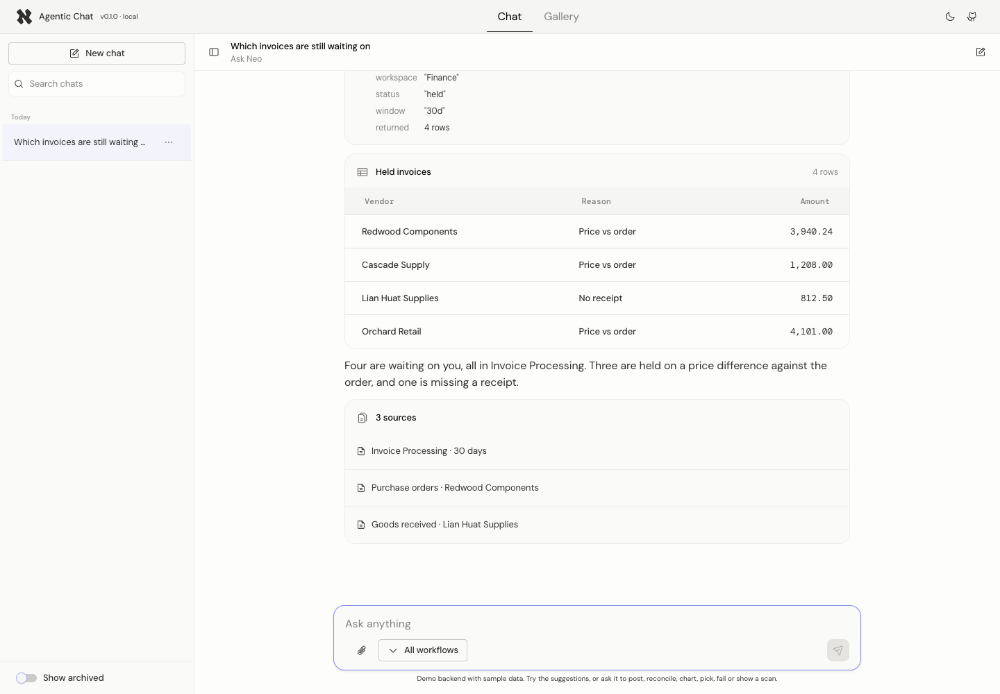
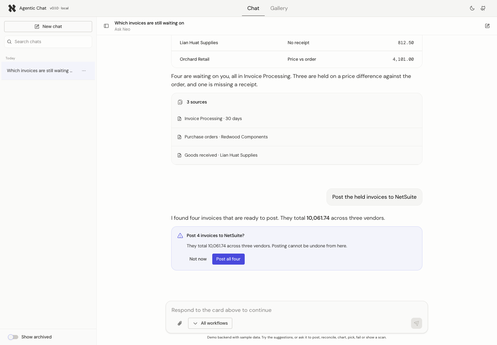
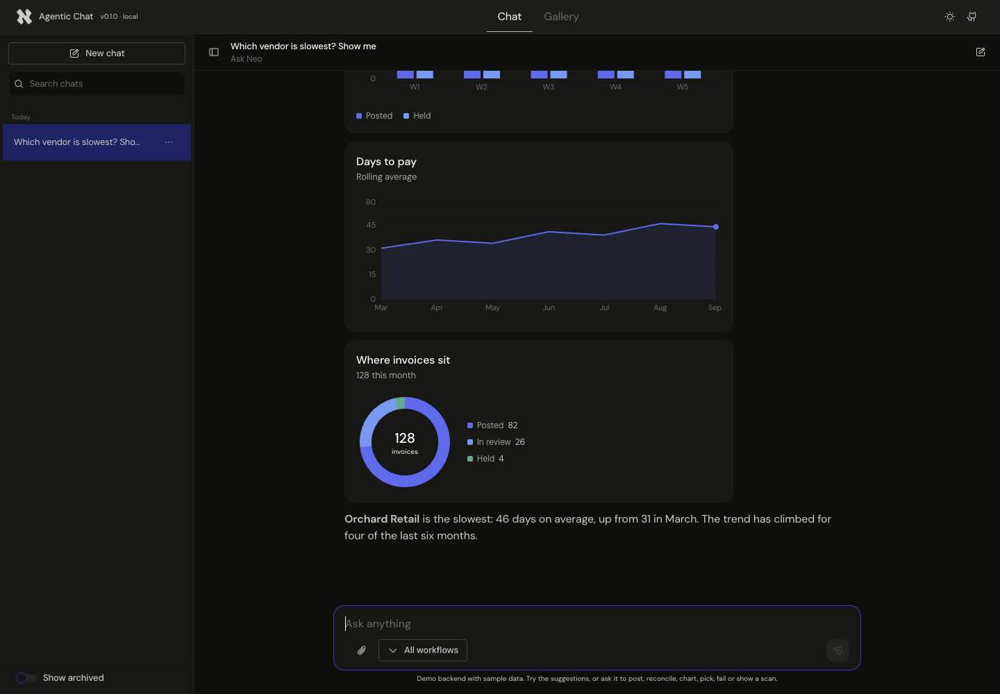

# @neofloai/agentic-chat

A React chat UI for agentic assistants. Point it at any backend that implements the **Neoflo chat standard** (schema v1, revision 1.2). You get streaming answers, chat history, human-in-the-loop decisions, tool activity, tables, charts and custom cards without building any of it yourself.

It's built on [`@neofloai/atoms`](https://github.com/neofloai/atoms), so it looks like the rest of your Neoflo product in light and dark.

**[Live demo](https://neofloai.github.io/agentic-chat-ui/#/chat)** · **[Component gallery](https://neofloai.github.io/agentic-chat-ui/#/gallery)** · [Backend contract](docs/backend-contract.md) · [Block contracts](docs/block-contracts.md)



## What you get

- **A complete chat in one component.** `<AgenticChat>` renders the history panel, the thread and the composer.
- **Streaming that holds up in production.** It handles SSE over `fetch`, snapshot-based deltas, cancel, retry, idle timeouts and dropped connections.
- **Human-in-the-loop.** Approval and choice cards pause the turn, lock the composer, and resume with your decision.
- **12 built-in blocks from the Figma sheets.** Text, thinking, tool call, table, sources, approval, choice, error, artifact, image, plan and charts.
- **Your own cards.** `defineBlock` registers a card, and `actions.emit` routes clicks into your app.
- **Chat history.** Search, date groups, rename, archive and delete, all with optimistic updates.
- **Configurable local persistence.** Choose session, local, memory, off, or your own storage, partitioned per user.
- **Three levels of control.** Use the styled UI, swap parts through slots, or go fully headless with hooks and primitives.
- **One standard for every product.** Each backend describes itself through `GET /v1/chat/config`, so the same UI hides what a product doesn't support. A conformance check tells a backend team what's left to fix.

## Contents

1. [Install](#install)
2. [Quick start](#quick-start)
3. [How it talks to your backend](#how-it-talks-to-your-backend)
4. [Configuration](#configuration)
5. [Chat history](#chat-history)
6. [Local persistence](#local-persistence)
7. [Human-in-the-loop](#human-in-the-loop)
8. [Blocks](#blocks)
9. [Customizing the UI](#customizing-the-ui)
10. [Headless](#headless)
11. [A backend that doesn't follow the schema](#a-backend-that-doesnt-follow-the-schema)
12. [Driving the chat from your app](#driving-the-chat-from-your-app)
13. [Mock backend](#mock-backend)
14. [Checking a backend](#checking-a-backend)
15. [Server rendering](#server-rendering)
16. [Troubleshooting](#troubleshooting)
17. [Versioning](#versioning)
18. [Contributing](#contributing)

## Install

The package installs straight from GitHub. It has no registry, needs no token, and follows semver through release tags:

```bash
npm install github:neofloai/agentic-chat-ui#semver:^0.1.0

# The UI is built on Atoms (skip it if you only use /headless or /core)
npm install github:neofloai/atoms#semver:^3.0.0

# Only if you use the chart blocks
npm install recharts
```

Requirements:

- React 18.2 or 19.
- A `git` binary on machines that install it. `node:*-alpine` and `-slim` images don't ship one (`apk add --no-cache git`).
- Atoms builds itself on install, so don't run `npm ci --ignore-scripts`.
- To try unreleased work, install a branch or commit (`github:neofloai/agentic-chat-ui#<branch>`). The package builds itself on install, the same way Atoms does.

| Import                               | What it contains                                                           | Needs      |
| ------------------------------------ | -------------------------------------------------------------------------- | ---------- |
| `@neofloai/agentic-chat`             | `<AgenticChat>`, every UI part and block, plus everything from `/headless` | Atoms      |
| `@neofloai/agentic-chat/headless`    | Runtime, adapters, hooks, primitives, block registry and parsers           | React only |
| `@neofloai/agentic-chat/core`        | The framework-free engine and schema types                                 | Nothing    |
| `@neofloai/agentic-chat/charts`      | `chartBlock` (bar, line, area, donut)                                      | `recharts` |
| `@neofloai/agentic-chat/mock`        | An in-memory backend on the standard, with demo scenarios                  | Nothing    |
| `@neofloai/agentic-chat/conformance` | A check that runs a real backend against the standard (also a CLI)         | Nothing    |

## Quick start

Mount `NeofloThemeProvider` once, give the chat a sized container, and hand it an adapter:

```tsx
import { NeofloThemeProvider } from '@neofloai/atoms';
import { AgenticChat, createRestAdapter } from '@neofloai/agentic-chat';
import { chartBlock } from '@neofloai/agentic-chat/charts';

const adapter = createRestAdapter({
  baseUrl: 'https://api.example.com',
  headers: async () => ({ Authorization: `Bearer ${await getAccessToken()}` }),
});

export function App() {
  return (
    <NeofloThemeProvider>
      <div style={{ height: '100vh' }}>
        <AgenticChat adapter={adapter} blocks={[chartBlock]} />
      </div>
    </NeofloThemeProvider>
  );
}
```

That's the whole integration. The chat creates a conversation, shows the server's greeting and suggested prompts, streams answers, and keeps history.

## How it talks to your backend

`createRestAdapter` implements the endpoints of the chat standard:

| #   | Call                                          | Used for                                                            |
| --- | --------------------------------------------- | ------------------------------------------------------------------- |
| 0   | `GET /v1/chat/config`                         | What the backend supports: features, models, sources, limits.       |
| 1   | `POST /v1/conversation`                       | New chat. The response supplies the greeting and suggested prompts. |
| 2   | `GET /v1/conversations`                       | The history panel                                                   |
| 3   | `GET /v1/conversations/{id}`                  | Opening a chat and its messages                                     |
| 4   | `PATCH /v1/conversations/{id}`                | Rename, archive, model, default sources                             |
| 5   | `DELETE /v1/conversations/{id}`               | Delete                                                              |
| 6   | `POST /v1/conversations/{id}/messages`        | Sending a turn, or resuming a HITL checkpoint. Streamed as SSE.     |
| 7   | `POST /v1/conversations/{id}/messages/cancel` | The Stop button                                                     |

It reads all nine stream events (`message_start` through `error`), treats `snapshot` as a full overwrite, and ignores event types it doesn't know. A newer backend therefore never breaks an older UI. Identity comes only from your `headers` or the session cookie. The library never puts user or tenant data in a payload, and never keeps a credential it was handed.

- **The config decides what shows.** The attach button, the scope picker, Archive and approval cards appear only when the backend's `capabilities` allow them. Model and source labels, the workflow catalog and the message length limit come from the config too. A backend without the endpoint (404) gets the defaults, or whatever you pass as `capabilities`.
- **Every message has a `client_message_id`.** A retry of a message the server never confirmed reuses it, so a flaky network or a double click never starts two replies. If the server already has it (409 `duplicate_message`), the chat reloads the conversation instead of showing an error.
- **Errors are read by code first.** `session_busy`, `rate_limited` (with a countdown), `connection_expired` (with Reconnect) and the rest each get the right action; a code the library doesn't know falls back to its HTTP status. Each error keeps the server's `request_id` for bug reports.
- **Stop matches the backend.** With `cancel: "disconnect"` it closes the stream at once; with `"server"` it calls endpoint 7 first.

[docs/backend-contract.md](docs/backend-contract.md) is the reference for backend teams. It covers auth and credentials, the config, error codes, ordering rules and retries. [docs/block-contracts.md](docs/block-contracts.md) defines the payload of every block type, and [docs/schema-gaps.md](docs/schema-gaps.md) lists what the standard still leaves open.

## Configuration

Every option works the same on `<AgenticChat>`, `<ChatProvider>` and `createChatRuntime`:

```tsx
<AgenticChat
  adapter={adapter}
  // The composer's "All workflows" picker. Groups are workspaces, items are workflows.
  scope={{ groups: [{ id: 'ws_finance', label: 'Finance', items: [{ id: 'ip', label: 'Invoice Processing' }] }] }}
  // Context from the page the chat sits in, merged into every turn.
  workflowContext={() => [{ workflow_name: 'ip', workspace_id: ['ws_finance'], context: { invoice_id: 'INV-1042' } }]}
  // The schema has no upload endpoint: your app uploads and returns the Attachment.
  attachments={{ accept: '.pdf,.xlsx,image/*', maxSize: 20 * 1024 * 1024, upload: uploadFile }}
  persistence={{ storage: 'local', scope: user.idHash, persist: { history: true } }}
  conversationId={params.id}
  onConversationChange={(id) => navigate(id ? `/chat/${id}` : '/chat')}
  onAction={(action) => handleCardAction(action)}
  onError={(error) => report(error)}
  labels={{ composerPlaceholder: 'Ask Neo anything' }}
/>
```

| Option                                    | Default         | What it does                                                                                                                                                                                                     |
| ----------------------------------------- | --------------- | ---------------------------------------------------------------------------------------------------------------------------------------------------------------------------------------------------------------- |
| `adapter`                                 | required        | The backend connection. Use `createRestAdapter` or your own.                                                                                                                                                     |
| `runtime`                                 |                 | Pass a runtime you created yourself instead of `adapter`. See [Driving the chat](#driving-the-chat-from-your-app).                                                                                               |
| `blocks`                                  | built-ins       | Extra or replacement block definitions. Later entries win.                                                                                                                                                       |
| `scope`                                   | none            | Groups and items for the workflow picker. By default the selection becomes `workflow_context`. Change that with `scope.toRequest`.                                                                               |
| `workflowContext`                         | none            | Page context added to every turn. It merges with the scope by `workflow_name`.                                                                                                                                   |
| `attachments`                             | off             | `{ upload, accept, maxSize, maxFiles }`. This turns on the paperclip button, drag-and-drop and paste.                                                                                                            |
| `persistence`                             | session storage | See [Local persistence](#local-persistence).                                                                                                                                                                     |
| `conversationCreation`                    | `'eager'`       | `'eager'` creates the chat when it opens, which is what fetches the greeting. `'lazy'` waits for the first message.                                                                                              |
| `hitl.composerWhilePaused`                | `'disabled'`    | Whether people can type while a card waits for a decision.                                                                                                                                                       |
| `conversationId` / `onConversationChange` |                 | A controlled active chat, for deep links. `null` means a new chat.                                                                                                                                               |
| `onAction`                                |                 | Receives `actions.emit(name, payload)` from cards.                                                                                                                                                               |
| `capabilities`                            | from the config | Feature switches (`hitl`, `attachments`, `workflowContext`, `archive`, `cancel`, `perTurnModel`, `perTurnSources`). They decide what shows until the backend serves its config, then can only turn more off.     |
| `onConnectionRequired`                    |                 | Called with `{ sourceId, code }` when a send fails with `connection_required` or `connection_expired`. Reconnect (for example `PUT /v1/connections/{sourceId}`), return `true`, and the message is retried once. |
| `onEvent` / `onError` / `onWarning`       |                 | Telemetry hooks for every stream event, error and recoverable warning.                                                                                                                                           |
| `labels`                                  | English         | Override any UI string, for copy changes or translation.                                                                                                                                                         |
| `streamIdleTimeoutMs`                     | `60000`         | How long a silent stream waits before it counts as dropped and becomes retryable.                                                                                                                                |
| `refreshOnFocus`                          | `true`          | Refresh history when the window regains focus.                                                                                                                                                                   |

`createRestAdapter` options:

| Option               | What it does                                                                                                                                                                                                                                 |
| -------------------- | -------------------------------------------------------------------------------------------------------------------------------------------------------------------------------------------------------------------------------------------- |
| `baseUrl`            | The API origin. The `/v1/...` paths are appended to it.                                                                                                                                                                                      |
| `headers`            | An object or an (async) function, called on every request so tokens stay fresh.                                                                                                                                                              |
| `onUnauthorized`     | Called once on a 401 with `{ code, message, requestId }`. `unauthenticated` means sign in again; a product code (`askneo.gate_required`, `askneo.workspace_required`) says where else to send the user. Return `true` to retry that request. |
| `retry`              | `{ retries, baseDelayMs, maxDelayMs }` for idempotent calls on 5xx, 429 and network errors. Message POSTs are never retried automatically.                                                                                                   |
| `paths`              | Override individual endpoint paths.                                                                                                                                                                                                          |
| `credentials`        | `'include'` sends the session cookie when the API is on another origin.                                                                                                                                                                      |
| `fetch`, `timeoutMs` | Transport details.                                                                                                                                                                                                                           |

## Chat history

The history panel lists conversations from row 2, newest first. It groups them into Today, Yesterday, Previous 7 days, Previous 30 days and Older, and searches titles as you type. Rename, archive and delete are optimistic, and they roll back if the server refuses.

- A new chat joins the list when its first message is sent. Empty chats never clutter history.
- A reply keeps streaming if you switch chats mid-answer. The list marks that conversation "Replying…".
- `message_stop.title` updates the title everywhere as soon as the server names the chat.
- Build your own panel with `useConversations()`, which returns items, groups, the active id, search, create, select, rename, remove, archive and refresh.

## Local persistence

```ts
persistence: {
  storage: 'session',        // 'session' | 'local' | 'memory' | 'none' | your StorageAdapter
  scope: user.idHash,        // partitions storage per user
  persist: {
    activeConversation: true, // reopen the same chat after a reload
    drafts: true,             // unsent text and uploaded attachments, per chat
    preferences: true,        // history panel open, model, scope selection
    history: false,           // cache the list and recent messages for instant loads
  },
  maxCachedConversations: 20,
  ttl: 7 * 24 * 60 * 60 * 1000,
}
```

- `history` is off by default because chat content can be sensitive. Turn it on together with `scope`.
- Cached chats render instantly, then reconcile with the server. The server always wins.
- A full or blocked storage never breaks the chat. It falls back to memory and reports once through `onWarning`.
- **Call `runtime.persistence.clear()` on logout.**
- A custom `StorageAdapter` can be async: IndexedDB, localforage, an encrypted store. See [docs/persistence.md](docs/persistence.md).

## Human-in-the-loop

When the backend emits a `checkpoint`, the card that asked the question becomes live. The turn stops with `stop_reason: "paused"`, the composer shows "Respond to the card above to continue", and the answer goes back through row 6:

```json
{
  "stream": true,
  "message": { "role": "user", "type": "hitl", "content": { "checkpoint_id": "z93hdnf02c", "decision": "approve" } }
}
```



The rest of the turn streams into the same message. A double click can't send two decisions. If the resume request fails, the card shows the error and lets the user try again.

Write your own decision card with `useHitl()`:

```tsx
function AmountCard({ data }: { data: AmountData }) {
  const hitl = useHitl();
  const [amount, setAmount] = useState(String(data.suggested));
  return (
    <BlockShell
      icon={<PencilSimpleIcon />}
      title={data.title}
      tone={hitl.isPending ? 'primary' : 'default'}
      footer={
        !hitl.isResolved && (
          <Button
            size="sm"
            loading={hitl.isSubmitting}
            disabled={!hitl.canSubmit}
            onClick={() => hitl.submit({ amount: Number(amount) })}
          >
            Confirm
          </Button>
        )
      }
    >
      <TextField label="Amount" value={amount} disabled={!hitl.canSubmit} onChange={(e) => setAmount(e.target.value)} />
    </BlockShell>
  );
}

export const amountCard = defineBlock({
  type: 'amount_confirmation',
  parse: parseAmount,
  render: ({ data }) => <AmountCard data={data} />,
});
```

## Blocks

A block is one piece of an answer. The renderer is picked by the block's `type`, falling back to its `category`. A product's own `<product>.<name>` type never falls back by category: without a registered renderer it shows its `fallback_text`.

| `type` (aliases)           | Renders                                                                                            | Payload                                                      |
| -------------------------- | -------------------------------------------------------------------------------------------------- | ------------------------------------------------------------ |
| `text` (`markdown`)        | Markdown on the Atoms type scale. Raw HTML is never rendered.                                      | [text](docs/block-contracts.md#text)                         |
| `thinking` (`reasoning`)   | "Thought for N seconds". Open while streaming, folds when done.                                    | [thinking](docs/block-contracts.md#thinking)                 |
| `tool_use` + `tool_result` | One card per tool call: name, inputs, results, duration. "Interrupted" when the result never came. | [tool_use](docs/block-contracts.md#tool_use-and-tool_result) |
| `tool_call` (`tool`)       | The older single-block form of the same card                                                       | [tool_call](docs/block-contracts.md#tool_call)               |
| `table`                    | A titled, sortable result set with a row count                                                     | [table](docs/block-contracts.md#table)                       |
| `sources` (`citations`)    | What the answer read. Items can link out or be selectable.                                         | [sources](docs/block-contracts.md#sources)                   |
| `approval`                 | Approve or reject a proposed action (HITL)                                                         | [approval](docs/block-contracts.md#approval)                 |
| `choice`                   | Single or multi-select question (HITL)                                                             | [choice](docs/block-contracts.md#choice)                     |
| `error`                    | Failure with a Try again button that respects `retry_after`                                        | [error](docs/block-contracts.md#error)                       |
| `artifact` (`document`)    | A generated file with a preview, full view and download                                            | [artifact](docs/block-contracts.md#artifact)                 |
| `image`                    | An image with a caption that opens larger                                                          | [image](docs/block-contracts.md#image)                       |
| `plan` (`steps`)           | The agent's steps as a live stepper                                                                | [plan](docs/block-contracts.md#plan)                         |
| `chart`                    | Bar, line, area and donut in Atoms colors (`/charts`)                                              | [chart](docs/block-contracts.md#chart)                       |

### Custom blocks

```tsx
import { AgenticChat, BlockShell, KeyValueList, defineBlock } from '@neofloai/agentic-chat';

export const invoiceCard = defineBlock<InvoiceCardData>({
  type: 'invoice_card',
  parse: (block) => ({
    id: String(block.invoice_id),
    vendor: String(block.vendor),
    total: String(block.total),
    status: String(block.status),
  }),
  render: ({ data, actions }) => (
    <BlockShell
      icon={<ReceiptIcon />}
      title={`Invoice ${data.id}`}
      meta={data.status}
      footer={
        <Button size="sm" onClick={() => actions.emit('open_invoice', { id: data.id })}>
          Open invoice
        </Button>
      }
    >
      <KeyValueList
        items={[
          { key: 'vendor', value: data.vendor },
          { key: 'total', value: data.total },
        ]}
      />
    </BlockShell>
  ),
  toText: (data) => `Invoice ${data.id}: ${data.vendor}, ${data.total}`,
});

<AgenticChat adapter={adapter} blocks={[invoiceCard]} onAction={(a) => a.name === 'open_invoice' && openInvoice(a.payload)} />;
```

- **Matching.** Use `type` (one or several), `category`, or `match(block)` for anything else. Later registrations override built-ins, so `{ ...approvalBlock, type: 'approval_card' }` maps a backend's own name onto a built-in card.
- **Safety.** If `parse` throws, the block falls back to the unknown-block renderer. A renderer that throws is caught by its own error boundary, so the rest of the answer still shows.
- **Streaming.** `applyDelta(block, delta, snapshot)` takes over how deltas apply to your block type.
- **`actions`.** `send(text)` starts a follow-up turn, `resume(decision)` answers a checkpoint, `emit(name, payload)` reaches your `onAction`, and `retry()` retries the last failed turn.
- **The kit.** `BlockShell`, `KeyValueList`, `Shimmer`, `ChartCard` and `useChartPalette` are the same pieces the built-in blocks use, so custom cards look native.

More in [docs/custom-blocks.md](docs/custom-blocks.md).

## Customizing the UI

**Slots** replace any part of `<AgenticChat>`: `Welcome`, `UserTurn`, `AssistantTurn`, `Header`, `History` and `Composer`.

```tsx
function Welcome() {
  const meta = useThreadMeta();
  const { send } = useChatActions();
  return (
    <Stack spacing={2} sx={{ alignItems: 'center', py: 8 }}>
      <Typography variant="h4">{meta.greeting}</Typography>
      <Button size="sm" onClick={() => send('What changed since yesterday?')}>
        Daily digest
      </Button>
    </Stack>
  );
}

<AgenticChat adapter={adapter} components={{ Welcome }} history={false} />;
```

- **Layout props.** `history`, `header`, `title`, `headerActions`, `maxWidth`, `composerProps` and `compactBelow`. Below 720px of container width, history becomes an overlay.
- **Compose it yourself.** `ChatThread`, `ChatComposer`, `ChatHistory`, `ChatHeader`, `WelcomeScreen`, `ChatSuggestions` and `RunStatus` all work inside a `ChatProvider`, in any layout you like.

### Composer controls

The composer's bottom row has two optional slots, plus the place of the built-in workflow picker. Pass them to `ChatComposer`, or through `composerProps` on `<AgenticChat>`:

| Prop             | Where it goes                                         | Use it for                                                                                                                                           |
| ---------------- | ----------------------------------------------------- | ---------------------------------------------------------------------------------------------------------------------------------------------------- |
| `leadingActions` | Left, after the attach button and the workflow picker | A tools or data-source picker, a mode switch                                                                                                         |
| `extraActions`   | Right, before Send                                    | A model picker, a mic                                                                                                                                |
| `scopePicker`    | Left, after the attach button                         | Omit it for the built-in workflow picker (it hides itself when there's no workflow catalog), pass your own node to replace it, or `false` to hide it |

`ComposerPicker` is the pill-and-menu control the workflow picker is built from (Figma Composer-scope and SourcePicker). It's controlled and knows nothing about what its items mean, so it works for tools, models, data sources or anything else:

```tsx
import { ComposerPicker } from '@neofloai/agentic-chat';

const [tools, setTools] = useState(['web', 'docs']);
const [model, setModel] = useState(['balanced']);

<AgenticChat
  adapter={adapter}
  composerProps={{
    leadingActions: (
      <ComposerPicker
        name="Tools"
        groups={[
          {
            id: 'tools',
            label: 'Tools',
            selectAll: true, // the heading selects or clears the group ("Select all" / "Deselect all")
            items: [
              { id: 'web', label: 'Web search' },
              { id: 'docs', label: 'Documents', description: 'Files uploaded to this workspace' },
            ],
          },
        ]}
        value={tools}
        onChange={setTools}
        footer={(close) => (
          <MenuItem
            onClick={() => {
              close();
              openToolSettings();
            }}
          >
            Tool settings…
          </MenuItem>
        )}
      />
    ),
    extraActions: (
      <ComposerPicker
        name="Model"
        multiple={false}
        items={[
          { id: 'fast', label: 'Fast' },
          { id: 'balanced', label: 'Balanced' },
        ]}
        value={model}
        onChange={setModel}
      />
    ),
  }}
/>;
```

| `ComposerPicker` prop                  | What it does                                                                                                                |
| -------------------------------------- | --------------------------------------------------------------------------------------------------------------------------- |
| `name`                                 | What is picked ("Tools"). The trigger's accessible name, and the default summary: "All tools", "Tools (2)", "No tools".     |
| `groups` / `items`                     | The choices, in groups with an optional `label` heading, or one plain list. Item ids must be unique across the picker.      |
| `value` / `onChange`                   | The selected item ids.                                                                                                      |
| `multiple`                             | `true` (default): checkboxes, and the menu stays open. `false`: one choice, which closes the menu and shows on the trigger. |
| `group.selectAll`                      | The group's heading also selects or clears its items, and says which on its right.                                          |
| `item.description`, `icon`, `disabled` | A second line, a 16px glyph, or an item that can't be changed (select-all leaves it as it is).                              |
| `triggerLabel`                         | Your own trigger text instead of the summary.                                                                               |
| `footer`                               | Under a rule at the bottom of the menu, for example a `MenuItem` that opens your own dialog. A function receives `close`.   |
| `disabled`, `loading`, `menuMinWidth`  | Self-explanatory. `loading` disables the trigger and marks it busy.                                                         |

The picker only holds the selection; deciding what it changes is up to you. To make it drive the chat, call the chat's actions in `onChange`, for example `setModel(id)` or `setDefaultSources(...)` from `useChatActions()` with the backend's `config.models` and `config.sources` from `useChatConfig()`. The summary strings come from `labels.pickerSummary`, `labels.pickerSelectAll` and `labels.pickerDeselectAll`. The picker also works outside a `ChatProvider`, with the default strings.

- **Theming.** Everything reads Atoms tokens, so it follows `NeofloThemeProvider`, including light and dark. Don't restyle the internals with CSS overrides. If Atoms lacks something, request it in Atoms.
- **Copy.** `labels` overrides any string. See `defaultLabels` for the full list.



## Headless

`@neofloai/agentic-chat/headless` has the same engine with no styling and no Atoms dependency:

```tsx
import {
  ChatProvider,
  Composer,
  Message,
  Thread,
  Block,
  defineBlock,
  parseText,
  useMessage,
} from '@neofloai/agentic-chat/headless';

const text = defineBlock({ type: 'text', category: 'content', parse: parseText, render: ({ data }) => <p>{data.text}</p> });

function AnyMessage() {
  const { message } = useMessage();
  return (
    <Message.Root>
      {/* A tool_result paired with its tool_use renders inside that card (Message.Blocks does this for you). */}
      {message.blocks
        .filter((b) => !b.pairedWith)
        .map((b) => (
          <Block key={b.id} block={b} message={message} />
        ))}
    </Message.Root>
  );
}

export function MyChat() {
  return (
    <ChatProvider adapter={adapter} blocks={[text]}>
      <Thread.Root>
        <Thread.Viewport>
          <Thread.Empty>Ask me anything.</Thread.Empty>
          <Thread.Messages components={{ UserMessage: AnyMessage, AssistantMessage: AnyMessage }} />
          <Thread.Status>{(label) => <span>{label}</span>}</Thread.Status>
        </Thread.Viewport>
        <Thread.ScrollToBottom>↓</Thread.ScrollToBottom>
      </Thread.Root>
      <Composer.Root>
        <Composer.Input />
        <Composer.Cancel>Stop</Composer.Cancel>
        <Composer.Send>Send</Composer.Send>
      </Composer.Root>
    </ChatProvider>
  );
}
```

- **Primitives.** `Thread`, `Message`, `Composer`, `Suggestions`, `ConversationList` and `Hitl` accept normal HTML props and `asChild`, and expose `data-*` state attributes for styling.
- **Hooks.** `useThread`, `useMessages`, `useRun`, `useComposer`, `useConversations`, `useScope`, `useHitl`, `useChatActions`, `useChatConfig`, `useCapabilities`, `usePreference` and `useChatEvent`.

See [docs/headless.md](docs/headless.md).

## A backend that doesn't follow the schema

`ChatAdapter` is the only seam. Keep the REST calls that match and translate the ones that don't:

```ts
import { createRestAdapter, type ChatAdapter } from '@neofloai/agentic-chat/core';

const base = createRestAdapter({ baseUrl: 'https://legacy.example.com' });

export const legacyAdapter: ChatAdapter = {
  ...base,
  async *sendMessage(conversationId, body, { signal }) {
    const reply = await legacyAsk(conversationId, body.message.content.default, signal);
    yield { type: 'message_start', message_id: reply.id, conversation_id: conversationId, run_id: reply.id };
    const block = { id: `${reply.id}:0`, type: 'text', category: 'content', text: reply.answer };
    yield { type: 'content_block_start', index: 0, block };
    yield { type: 'content_block_stop', index: 0, block };
    yield { type: 'message_stop', message_id: reply.id, stop_reason: 'end_turn' };
  },
};
```

## Driving the chat from your app

Create the runtime outside React to reach it from anywhere:

```tsx
export const chat = createChatRuntime({ adapter, persistence: { storage: 'session' } });

function AskAboutInvoice({ invoiceId }: { invoiceId: string }) {
  return (
    <Button
      onClick={async () => {
        await chat.newConversation();
        await chat.send(`Why is invoice ${invoiceId} on hold?`, {
          workflowContext: [{ workflow_name: 'ip', workspace_id: [], context: { invoice_id: invoiceId } }],
        });
      }}
    >
      Ask Neo about this invoice
    </Button>
  );
}

<AgenticChat runtime={chat} />;

// On logout
await chat.persistence.clear();
chat.dispose();
```

The runtime also exposes `cancel`, `retry`, `reconnect`, `resume`, `selectConversation`, `renameConversation`, `deleteConversation`, `setModel`, `setDefaultSources`, `loadConfig`, the `chatConfig` store and `on('event' | 'error' | 'warning' | 'activeChange', listener)`. Several runtimes can share a page.

## Mock backend

`@neofloai/agentic-chat/mock` runs a backend on the standard in memory: the config endpoint, `selected_model`, `client_message_id` with duplicate detection, error envelopes and paired tool calls. Use it to build UI before the API exists, in tests, and in demos. The [live demo](https://neofloai.github.io/agentic-chat-ui/#/chat) runs on it.

```tsx
import { createMockAdapter } from '@neofloai/agentic-chat/mock';

const adapter = createMockAdapter({
  latency: 200,
  scenarios: [
    {
      name: 'invoice',
      match: (prompt) => prompt.includes('invoice'),
      run: async (w) => {
        await w.status('Looking it up');
        await w.block({ type: 'invoice_card', category: 'ui', invoice_id: 'INV-1042', vendor: 'Acme', total: '$1,200' });
        await w.text('Here it is.');
      },
    },
  ],
});
```

The writer has `status`, `text`, `thinking`, `tool` (a `tool_use` and its `tool_result`), `block` (with streamed `snapshots`), `pause` (a HITL checkpoint with an `onResume` continuation), `error` and `wait`. Cancel and abort work the same as on a real backend.

Pass `config` to change what the mock's config reports (`null` behaves like a backend without one). Its invoice-processing connection starts expired, so a prompt that mentions "invoice processing" fails with `connection_expired` until something calls `adapter.connect('invoice_processing')`, which is how the demo shows Reconnect.

## Checking a backend

`@neofloai/agentic-chat/conformance` calls a backend the way the chat will and reports every gap against the standard: missing endpoints, identity fields or credentials in bodies, `model` instead of `selected_model`, a stream that doesn't echo `client_message_id`, tools without exactly one result, error bodies outside the envelope, and more. It creates one conversation, sends one message and deletes the conversation. Run it in CI against a dev or staging deployment:

```bash
npx agentic-chat-conformance --base-url https://askneo.dev.example --header "Cookie: session=$SESSION"
```

```ts
import { formatReport, runConformance } from '@neofloai/agentic-chat/conformance';

const report = await runConformance({ baseUrl, headers: { Authorization: `Bearer ${token}` } });
if (!report.ok) throw new Error(formatReport(report));
```

Failures break the contract; warnings don't fail the run. Sending a message calls the model, so pass `--no-messages` (or `sendMessages: false`) for a run that mustn't. [docs/backend-contract.md](docs/backend-contract.md#8-conformance-check) has the details.

## Server rendering

The library is plain React and works in any React app. If yours renders on the server:

- Nothing touches `window` or storage at import time or during server render. Persistence hydrates on the client.
- The React entry points (`.`, `/headless`, `/charts`) are marked `"use client"`. `/core`, `/mock` and `/conformance` contain no React, so they can also run in server code.
- Create the adapter and render `<AgenticChat>` in a client component. An adapter holds functions, and functions can't be passed as props from server-rendered components.

## Troubleshooting

| Symptom                                                                   | Fix                                                                                                                |
| ------------------------------------------------------------------------- | ------------------------------------------------------------------------------------------------------------------ |
| `Cannot find module ./dist/index.mjs` from Atoms                          | Your install skipped scripts. Remove `--ignore-scripts`.                                                           |
| `git: not found` in CI or Docker                                          | Install git in the image: `apk add --no-cache git`.                                                                |
| The chat has no height, or never scrolls                                  | Give its container a height (`height: 100vh`, or a flex child with `min-height: 0`).                               |
| Wrong fonts or colors, plus a console warning about `NeofloThemeProvider` | Mount `NeofloThemeProvider` once at the root.                                                                      |
| An "Unsupported content: …" box                                           | The backend sent a block type nothing renders. Register a `defineBlock` for it. The box only shows in development. |
| Cards do nothing when clicked                                             | Handle `onAction`. Cards emit, and your app decides.                                                               |
| A 401 loop                                                                | Return `false` from `onUnauthorized` when the refresh fails. The error then surfaces instead of retrying.          |
| No attach button, scope picker, Archive or approval cards                 | The backend's config turns them off. Check `useCapabilities()`, or the config endpoint's `capabilities`.           |
| A connection error with no Reconnect button                               | Pass `onConnectionRequired`. Without it the chat can only show the message.                                        |
| A tool card says "Interrupted"                                            | The reply ended without that tool's `tool_result`. Every `tool_use` needs exactly one, including on error.         |

## Versioning

The package follows semver. Pin a range (`#semver:^0.1.0`) and `npm update` picks up fixes and features. Crossing a major version is a deliberate `package.json` edit. **Any change to the backend or block contract is a major version.** Each release lists its changes in [CHANGELOG.md](CHANGELOG.md) and on the GitHub Releases page.

## Contributing

```bash
git clone https://github.com/neofloai/agentic-chat-ui.git && cd agentic-chat-ui
npm install
npm run dev            # playground at http://localhost:5173 (chat + gallery on the mock backend)
npm run check          # typecheck, lint, tests, build, package validation
```

- Point the playground at a real backend with `VITE_CHAT_BASE_URL` and `VITE_CHAT_TOKEN` in `playground/.env.local`. That mode only exists locally; the public demo compiles it out.
- New UI goes into the gallery (`playground/src/GalleryPage.tsx`) in every state, in light and dark.
- **Import only from Atoms' public entry points.** Lint enforces it, along with keeping `/headless` free of Atoms and `/core` free of React.
- Add a changeset (`npm run changeset`) to every PR that changes the library. Merging the generated "Version packages" PR tags the release with a prebuilt `dist/`, creates the GitHub Release, and redeploys the demo.

Project layout:

```
src/core        engine: schema types, REST/SSE adapter, stores, persistence, runtime (no React)
src/react       provider, hooks, headless primitives
src/registry    defineBlock, block resolution, error boundary
src/blocks      block parsers shared by every renderer
src/ui          the Atoms UI: shell, blocks, history, kit
src/charts      chart blocks (Recharts)
src/mock        the in-memory backend
src/conformance the backend conformance check and its CLI
playground      the demo app and component gallery (GitHub Pages)
examples        the README's code, type-checked in CI
docs            contracts and guides
```

## License

To be decided by Neoflo before the first public release. The package is marked `UNLICENSED` until then.
